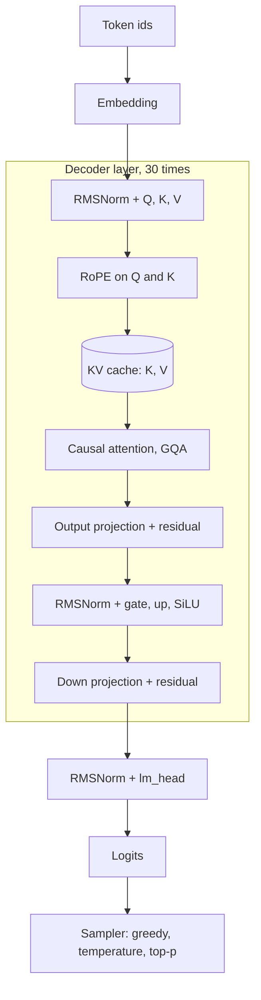
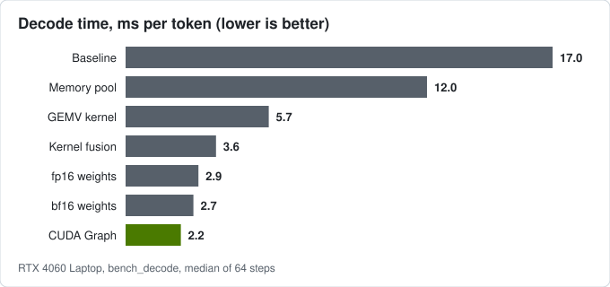

# MiniInfer

[](https://github.com/Nostradam4ik/miniinfer/actions/workflows/ci.yml)
(CI has no GPU: it checks formatting, builds and runs the CPU-only tests. GPU correctness is verified locally.)

An LLM inference engine written from scratch in C++/CUDA: hand-written kernels, no cuDNN, no PyTorch at
runtime. It runs [SmolLM2-135M](https://huggingface.co/HuggingFaceTB/SmolLM2-135M) (Llama architecture, GQA,
tied embeddings, 30 layers, 9 query / 3 KV heads) end to end on the GPU. It is a learning project: the goal
was to understand where the time goes in LLM decoding.

**Result:** decode speed went from **59 tokens/s (fp32, no CUDA Graph) to 455 tokens/s (bf16 weights + CUDA
Graph)**, that is 17.0 to 2.2 ms/token (7.7x), on an NVIDIA GeForce RTX 4060 Laptop (Ada, sm_89, 8 GB,
~256 GB/s), measured by `bench_decode.exe` (median of 64 steps). In the default mode, logits on a short
reference prompt are within 1.05e-5 of PyTorch (relative to the largest logit), and greedy generation matches
it token for token on two test prompts, 20 tokens each ([more checks](#how-correctness-is-established)). An
opt-in [tensor core prefill](docs/tensor-core-prefill.md) is faster and less exact.

Unedited generated text of one run of `.venv\Scripts\python.exe tools\chat.py "Once upon a time" --max 60`
(greedy, the default; the timing line is left out). This is a base model: it continues text, it does not answer
questions.

> Once upon a time, there was a little girl named Lily. She lived in a big house with her family, but she
> didn't have many toys to play with. One day, her mom told her that she could go to a special place called a
> "school" to learn new things and become a teacher. Lily

## How it works



- **Memory:** a small `Tensor` type, a pooled GPU allocator and an arena for CUDA Graph buffers.
- **Matmul:** naive, shared-memory tiled and 4x4 register-tiled kernels (benchmarked against cuBLAS), a
  bandwidth-oriented GEMV for decoding (M <= 4) and an opt-in WMMA kernel on tensor cores for prefill.
- **Transformer ops:** RMSNorm, RoPE, attention with a KV cache, SiLU-gated MLP, embedding, and fused versions
  of them for decoding.
- **Weights:** fp16 or bf16 storage with fp32 accumulation.
- **CUDA Graph:** the decode step is captured once and replayed with one launch. Token and position live in
  device memory, so one graph serves every position.

## From 17.0 to 2.2 ms per token



Measured with `bench_decode.exe` (median of 64 steps, including the logits copy to the host). The
memory-bandwidth floor for fp32 weights is ~540 MB per token at ~256 GB/s = ~2.1 ms
(~1.05 ms for bf16, which is half the size).

| Step | ms/token | tok/s | What changed |
|---|---|---|---|
| Baseline | 17.0 | 59 | `cudaMalloc`/`cudaFree` for each of 455 ops per token |
| + memory pool, no needless zeroing | 12.0 | 84 | 0 `cudaMalloc` per token; the implicit sync from `cudaFree` is gone |
| + GEMV kernel for M <= 4 | 5.7 | 174 | M=1 matmul: 9.0 to 2.3 ms per token (`bench_ops.exe`) |
| + kernel fusion | 3.6 | 278 | 455 to 184 launches per token |
| + fp16 weights | 2.9 | 347 | weights 651 to 326 MB |
| + bf16 weights | 2.7 | 373 | same size, but lossless because the checkpoint is stored in bf16 (fp16 flushes 24 of 163M weights to zero) |
| + CUDA Graph (bf16) | **2.2** | **455** | one launch per step; same results as without the graph |

Total: 7.7x. Run-to-run spread is about +-0.2 ms (laptop GPU clocks vary with temperature).

I profiled before optimizing. What was measured, what it showed, and what followed:

1. **One small matmul was slow.** `bench_ops.exe` showed a 64x64-tile matmul taking 44 us at M=1 regardless of
   size, even for a raw launch with no allocation. So the cause was the kernel shape (tiles built for large M),
   not memory or launches. Fix: a separate GEMV kernel.
2. **Most ops cost little more than a launch.** `bench_layer_ops.exe` showed QKV, RoPE, attention and o_proj at
   9-12 us against ~7.5 us for an empty launch. Fix: kernel fusion, then CUDA Graphs.
3. **After the graph, launches are no longer the bottleneck.** `bench_layer_ops.exe --graph` (bf16) showed
   ~2.05 ms of pure graph time: ~1.1 ms of weight streaming from DRAM plus ~0.9 ms of accumulated latency from
   ~180 small kernels. `lm_head` already runs at ~243 GB/s, close to the memory limit.
4. **A negative result:** GEMV vector width (1, 2 or 4 columns per thread) made no measurable difference, even
   inside the graph.

**Prefill** was optimized next. Nsight Systems traces led to two changes: loading `float4` in the attention
dot product, then four elements at a time in the tiled matmul. At 512 tokens the two together took prefill from
107.5 to 55.0 ms (`bench_decode.exe --dtype bf16`, median of 7 alternated rounds). The matmul change was 22-24%
faster in a standalone harness but gained much less inside the model; the cause is not known.
[Details](docs/benchmarks.md#prefill).

A later trace showed attention as the largest cost of a 512-token `wmma` prefill. Three query heads share each
KV head, so one block now serves all three and loads K and V once. In a separate before/after run
(`bench_decode.exe --dtype bf16`, median of 7 alternated rounds) a 512-token prefill went from 55.53 to 42.40 ms
in the default mode and from 37.97 to 25.42 ms with `wmma`, with bitwise identical logits (checked in the
default mode). At 32 tokens and below there was no difference beyond the spread.
[Details](docs/benchmarks.md#shared-k-and-v-loads-in-attention).

## How correctness is established

- Every kernel has a CPU reference implementation.
- Activations are compared with PyTorch layer by layer, then logits and greedy generation end to end.
- The matmul tests put NaN padding after the data, because out-of-bounds reads normally hit zeroed memory and
  go unnoticed. NaN-filled pool blocks catch outputs that a kernel does not write. The difference helper treats
  NaN as a failure (`std::fmax` silently ignores NaN).
- CUDA Graph against the eager path in fp32, fp16 and bf16: the test requires bitwise identical K/V caches and
  logits within 1e-6 relative difference.
- Bugs were injected on purpose (mutation checks) to confirm that the tests actually fail.
- There are 170 tests, including comparisons against PyTorch.

The opt-in `--prefill-matmul wmma` mode is not expected to match: it rounds activations to bf16. Compared with
PyTorch (fp32) on one 497-token text, it kept the same most likely next token at 492 of 497 positions (the
default: 497 of 497). The largest logit difference at 17 sampled positions was 0.79. For this comparison
`lm_head` also ran on tensor cores; in generation it does not. The mode saved 31-33% of prefill time at 32 to
512 tokens (`bench_decode.exe --dtype bf16`, median of 7 alternated rounds, before the shared attention change). One text and three short prompts do
not show that output stays the same on other input.
[Speed and accuracy tables](docs/tensor-core-prefill.md).

## Comparison with llama.cpp

Same model, same GPU, llama.cpp build `b12728`. Median of 7 rounds in tok/s, min to max in parentheses.
**This table was measured before the shared attention change above, and the comparison has not been repeated.**
In it, MiniInfer's prefill was clearly slower than llama.cpp at 512 tokens.

| Engine | Decode | Prefill, 128 tokens | Prefill, 512 tokens |
|---|---|---|---|
| MiniInfer bf16 (CUDA Graph for decode) | 407 (388-441) | 8,460 (8,226-8,482) | 9,294 (9,149-9,329) |
| MiniInfer bf16, no graph | 342 (188-360) | | |
| MiniInfer bf16, `wmma` prefill (rounds activations to bf16) | | 12,561 (10,847-12,673) | 13,502 (13,152-13,534) |
| llama.cpp BF16 | 369 (336-378) | 11,282 (6,932-13,075) | 23,132 (21,930-23,782) |
| llama.cpp Q8_0 | 429 (417-461) | 11,366 (9,219-11,925) | 23,868 (22,968-24,514) |
| llama.cpp Q4_K_M | 446 (403-462) | 10,265 (9,879-11,036) | 20,429 (18,413-23,020) |

- **Prefill:** In that run, before the change, at 512 tokens llama.cpp BF16 was 2.5x faster than the default
  mode and 1.7x faster than `wmma`. MiniInfer's 512-token prefill has since become faster, so the gap is now
  smaller, but by how much was not measured: compare numbers only within one run. The 128-token column was
  unstable (see the llama.cpp BF16 range), so do not rely on it. Ratios differ between runs.
- **Decode:** MiniInfer is 1.10x faster than llama.cpp BF16 here, which does **not** show that it is the better
  engine. It is hard-wired for one architecture and replays one CUDA Graph. Without the graph it is slower than
  llama.cpp BF16, and quantized llama.cpp is faster than MiniInfer even with the graph.
- **Settings differ:** llama.cpp ran with its defaults, which store the KV cache in fp16 (MiniInfer uses fp32)
  and keep the token embedding lookup on the CPU.
- **Why 407 here and 455 above:** these are separate runs measured differently. 455 comes from the median step
  of a 64-step `bench_decode.exe` run. 407 is the median over 7 rounds, alternated with the other
  configurations, of the mean time per token of a 128-step run. How much of the gap each difference explains
  was not measured.
- One laptop GPU, Windows, one tiny model. Do not extrapolate to larger models or batched serving.

[Method, all caveats and how to reproduce](docs/benchmarks.md#comparison-with-llamacpp).

## What's next

None of these has been tried yet.

- **Prefill, the largest known gap.** The WMMA kernel is simple. To try: `mma.sync` and `ldmatrix` in PTX, and a
  better tile choice for short prompts.
- **Decode.** Device-side argmax for greedy decoding (skips the 196 KB logits copy every step, est.
  0.1-0.3 ms), bigger fusions to cut the ~0.9 ms of small-kernel latency, and int8/int4 weights (the quantized
  llama.cpp results suggest a modest gain on a model this small).

## Limitations

- Single model family (Llama-style, small), single GPU, batch size 1 in the optimized decode path.
- Attention keeps scores in shared memory, so the context is limited to 12,256 tokens.
- Tokenization is done in Python, not in C++.
- Tuned and measured on one GPU only.

## Build

Requirements: an NVIDIA GPU, a CUDA Toolkit (developed with 13.5), CMake 3.24+, Ninja and a C++17 compiler
(on Windows: Visual Studio 2022 or its Build Tools). On Windows, from any terminal, with `CUDA_PATH` pointing
to the toolkit, run `build.bat`. With the compiler and `nvcc` already on `PATH`:

```
cmake --preset release
cmake --build --preset release
```

The default target is compute capability 8.9. For another GPU add `-DCMAKE_CUDA_ARCHITECTURES=<cc>` (or
`native`) to the configure step or to `build.bat`. The GPU results here were measured on Windows only.

## Run

Set up the model and the PyTorch reference once (downloads SmolLM2-135M, writes `model/` and `reference/`):

```
py -m venv .venv
.venv\Scripts\python.exe -m pip install torch --index-url https://download.pytorch.org/whl/cpu
.venv\Scripts\python.exe -m pip install transformers safetensors numpy huggingface_hub
.venv\Scripts\python.exe tools\export_reference.py
```

Generate text (bf16 weights and CUDA Graph are on by default in `chat.py`):

```
.venv\Scripts\python.exe tools\chat.py "Once upon a time" --max 60
.venv\Scripts\python.exe tools\chat.py "The best way to learn programming is" --max 60 --temp 0.8 --top-p 0.95 --seed 3
```

Tokenization happens in Python; `chat.py` passes token ids to `build\generate.exe` (`generate.exe --help`,
flags `--dtype f32|f16|bf16`, `--graph`). Benchmarks: `bench_decode.exe [--dtype bf16] [--graph]`,
`bench_ops.exe`, `bench_layer_ops.exe [--graph]`, `matmul.exe <N>`
([matmul results](docs/benchmarks.md#matmul-benchmark-fp32-gflops)).

## Tests

```
build\tests.exe            # all tests
build\tests.exe matmul     # only tests with "matmul" in the name
```

The `ref_*` tests need `model/` and `reference/` from the step above. Without them they print a "skipped"
message and still pass, so check that the message is absent.

## Development

[CONTRIBUTING.md](CONTRIBUTING.md) describes the checks and C++/CUDA conventions; [AGENTS.md](AGENTS.md) gives
the same project knowledge to coding agents ([CLAUDE.md](CLAUDE.md) points to it). `pre-commit` runs
clang-format and ruff. Parts of this project were developed with AI assistance (Claude Code); see the commit
trailers.

## Project layout

```
src/        kernels and engine (ops.cu, gemv.cu, ops_fused.cu, wmma.cu, lowp.cu, model.cuh, graph.cuh, ...)
            bench_*.cu, generate_cli.cu, matmul.cu: executables
tests/      test framework and tests
tools/      export_reference.py (model + PyTorch reference), chat.py (tokenization + CLI wrapper),
            compare_llamacpp.py (benchmark against llama.cpp)
docs/       benchmark details, tensor core prefill, design documents
```

## License

MIT, see [LICENSE](LICENSE).
